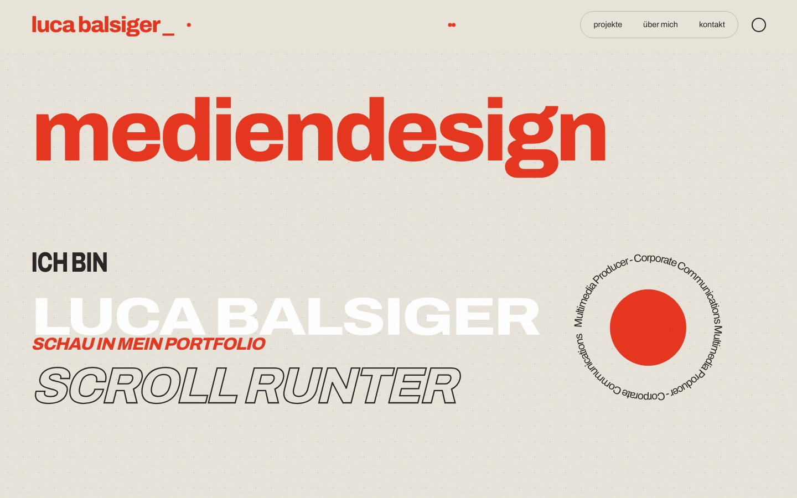
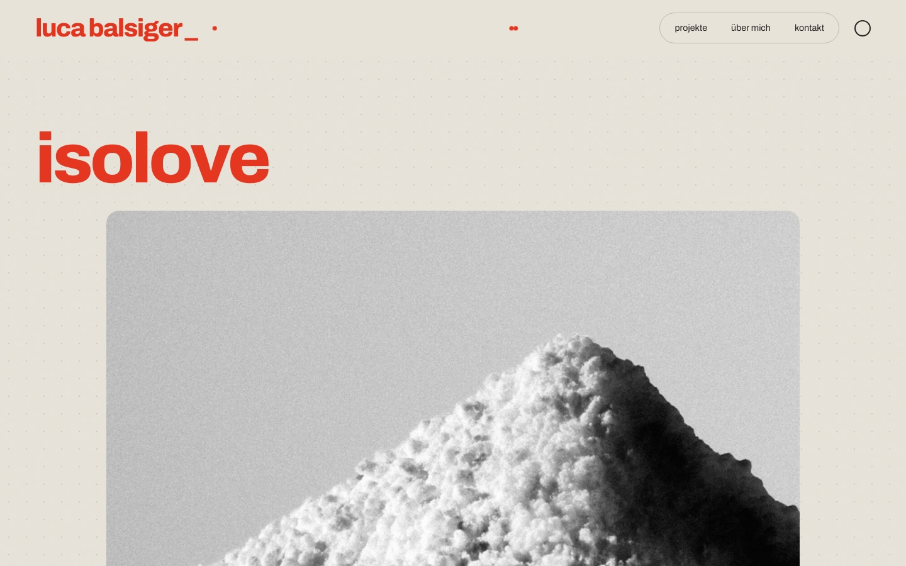
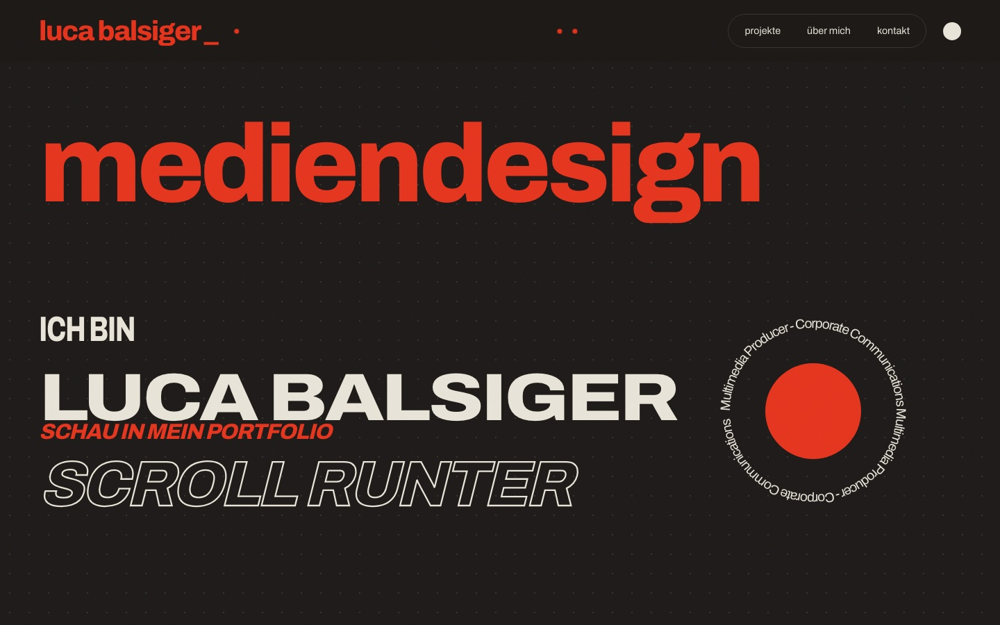
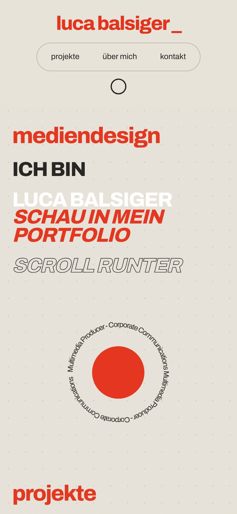

# Portfolio von Luca Balsiger
> Persönliches WordPress-Theme. Entwickelt im Modul IM5, HS26, FH Graubünden, auf Basis des IM5-Starter-Themes.

Das Portfolio zeigt ausgewählte Projekte von Luca Balsiger in einem eigenen WordPress-Theme ohne Page Builder und ohne CSS-Framework. Seiten werden im Backend aus Modulen zusammengesetzt, Projekte über einen eigenen Post Type gepflegt. Prägend sind die typografischen Intro-Zeilen auf der Startseite, die sich automatisch an die Breite anpassen, Seitenübergänge, bei denen das Projektbild aus der Kachel in die Projektseite gleitet, sowie ein Dark Mode und lokal eingebundene Schriften ohne Anfragen an Dritte.

Interaktiv wird das Portfolio durch eigene Datenbank-Tabellen und REST-Endpunkte: Besucher:innen können Projekten Applaus geben und über ein Kontaktformular mit Spam-Schutz schreiben. Aufrufe, Applaus und Nachrichten erscheinen im Backend. Ein Modul zeigt die aktuellen GitHub-Repos über die GitHub-API.

Live: [lucabalsiger.ch](https://lucabalsiger.ch)

---

## Live-Version

- Webseite: [https://lucabalsiger.ch](https://lucabalsiger.ch)
- Gehostet bei Infomaniak (Webhosting, PHP 8.3, SSL über Let's Encrypt)

---

## Screenshots

| Startseite | Projektseite |
|---|---|
|  |  |

| Dark Mode | Mobile |
|---|---|
|  |  |

<!-- Aufgenommen am 23.11.2026 mit Chrome (Headless), lokal. Nach dem Go-Live bei Bedarf ersetzen. -->

---

## Tech-Stack

- **WordPress** mit eigenem Theme (klassisches PHP-Theme, kein Block-Theme)
- **PHP 8.0+** (Union Types, `match`, `str_contains`)
- **Carbon Fields** für alle Inhaltsfelder, eingebunden als **WordPress-Plugin** (`wp-content/plugins/carbon-fields`), nicht über Composer. Das Theme lädt Carbon Fields nicht selbst, sondern registriert seine Felder über den Hook `carbon_fields_register_fields`.
- **HTML** und **CSS** ohne Framework, mit CSS-Variablen und verschachtelten Selektoren
- **Vanilla JavaScript** als ES-Modul (`type="module"`), ohne Bibliotheken und ohne Build-Schritt, mit `fetch()` für die REST-Endpunkte
- **Eigene Datenbank-Tabellen** über `$wpdb` und `dbDelta()`: Aufrufe und Applaus pro Projekt, Nachrichten aus dem Kontaktformular
- **WordPress REST API** mit eigenen Endpunkten unter `/wp-json/portfolio/v1/`
- **GitHub REST API**, serverseitig abgerufen mit `wp_remote_get()` und zwischengespeichert als Transient
- **View Transitions API** für Seitenübergänge zwischen Projektübersicht und Projektseite
- **Strukturierte Daten** (JSON-LD nach schema.org) und Open Graph für Suchmaschinen und Social Media
- **Lokale Webfonts** im Format woff2: Archivo, Space Grotesk, Big Shoulders Display, Barlow Condensed

---

## Voraussetzungen und Installation

**Voraussetzungen**
- WordPress 6.5 oder neuer (entwickelt mit WordPress 7.1). Ältere Versionen funktionieren dank Fallback beim Laden von `main.js` ebenfalls.
- PHP 8.0 oder neuer
- Plugin **Carbon Fields**, installiert und aktiviert
- Empfohlen: Plugin **«Safe SVG»**, das hochgeladene SVG-Dateien bereinigt

**Installation**
1. Den Theme-Ordner `portfolio` nach `wp-content/themes/` legen.
2. Im Backend unter **Design > Themes** das Theme «Portfolio von Luca Balsiger» aktivieren.
3. Unter **Design > Menüs** zwei Menüs anlegen und den Positionen «Hauptnavigation» und «Rechtliches» zuweisen.
4. Im Menüpunkt **Globales** Logo, E-Mail-Adresse, Footer-Text, Socials, GitHub-Benutzername, Standard-Beschreibung und Vorschaubild ausfüllen.
5. Unter **Einstellungen > Lesen** eine statische Seite als Startseite festlegen.
6. Unter **Einstellungen > Allgemein** die Sprache «Deutsch (Schweiz)» wählen, damit die Seite `lang="de-CH"` ausgibt.
7. Unter **Einstellungen > Datenschutz** die Datenschutzseite auswählen. Das Kontaktformular verlinkt sie.
8. Einmal **Einstellungen > Permalinks** öffnen und speichern, damit die URLs der Projekte (`/projekt/...`) aktiv sind.

Die eigenen Datenbank-Tabellen legt das Theme beim ersten Seitenaufruf selbst an, dafür ist kein Schritt nötig.

Eine ausführliche Anleitung für Hosting und Entwicklungsumgebung steht in [`manuals/installation.md`](manuals/installation.md).

---

## Aufbau des Themes

### 📄 Templates im Hauptordner
WordPress wählt das passende Template anhand der Template-Hierarchie. Alle Templates haben den gleichen Aufbau: Header, Layout-Header, `<main>`, Layout-Footer, Footer. Der eigentliche Inhalt kommt aus `frontend/views/pages/`.

| Datei | Was drin ist |
|---|---|
| `page.php` | Alle Seiten (Pages), lädt die Module |
| `single-project.php` | Projektdetailseite |
| `404.php` | Seite nicht gefunden, mit Link zur Startseite |
| `index.php` | Fallback, wenn kein anderes Template passt |
| `header.php` / `footer.php` | HTML-Gerüst mit `wp_head()` und `wp_footer()` |

### 🔧 Ordner `backend`
Alle Dateien für Funktionalität und CMS-Konfiguration. Hier wird gearbeitet, wenn neue Felder, Post Types oder Logik gebraucht wird.

| Ordner | Was drin ist |
|---|---|
| `admin/` | Eigene Ansichten im Backend: Statistik mit Spalten in der Projektliste, Dashboard-Widget und Zurücksetzen (`_stats.php`), Seite «Nachrichten» aus dem Kontaktformular (`_messages.php`) |
| `carbonfields/` | CMS-Felder für Seiten, Projekte und globale Einstellungen (Carbon Fields) |
| `cpt/` | Custom Post Type «Projekte» |
| `db/` | Eigene Datenbank-Tabellen `portfolio_stats` (Aufrufe und Applaus pro Projekt) und `portfolio_messages` (Nachrichten aus dem Kontaktformular), legen sich selbst an |
| `enqueue/` | Einbinden von `main.css` und `main.js` über WordPress, mit Cache-Busting |
| `getter/` | Funktionen, die Daten aus der Datenbank holen und für Templates aufbereiten |
| `helpers/` | Allgemeine Hilfsfunktionen, die überall genutzt werden können |
| `init/` | WordPress-Basis-Setup: Bildgrössen, Seitentitel, Bereinigung, SVG-Upload (nur Admins) |
| `mail/` | Mailversand ohne Plugin: Umschlag-Absender passend zur Domain (DMARC), optional SMTP mit Zugangsdaten aus `wp-config.php` |
| `nav/` | Navigationsmenüs registrieren |
| `seo/` | Angaben für Suchmaschinen und Social Media im `<head>`: Beschreibung, Open Graph, Canonical, strukturierte Daten (JSON-LD), noindex für 404 |
| `rest/` | Eigene REST-Endpunkte unter `/wp-json/portfolio/v1/`: Aufrufe und Applaus zählen (`_stats.php`), Kontaktformular mit Spam-Schutz und Mailversand (`_contact.php`) |
| `tax/` | Taxonomie «Projektkategorien» |

### 🏠 Ordner `frontend`
Alle Dateien für die Darstellung der Webseite.

| Ordner | Was drin ist |
|---|---|
| `assets/fonts/` | Lokale Schriftdateien (Archivo, Space Grotesk, Big Shoulders Display, Barlow Condensed) und Lizenz `OFL.txt` |
| `scripts/main.js` | Alle JavaScript-Funktionen |
| `styles/main.css` | Alle Stile des Themes |
| `views/layout/` | Header und Footer der Webseite |
| `views/modules/` | Ein PHP-Template pro Modul |
| `views/pages/` | Templates für Seiten-, Projekt- und 404-Ansicht |
| `views/partials/` | Wiederverwendbare Teilkomponenten (Badge, Galerie) |
| `views/teaser/` | Kachelansicht für Projekte in der Übersicht |

### 📸 Ordner `docs`
Screenshots für dieses README (`docs/screenshots/`). Das Vorschaubild für die Theme-Übersicht im Backend liegt als `screenshot.png` im Hauptordner, wie WordPress es verlangt.

### 📚 Ordner `manuals`
Anleitungen für häufige Erweiterungen und Einrichtungsschritte. Die Anleitungen sind so geschrieben, dass auch eine KI sie lesen und bei der Umsetzung unterstützen kann.

---

## Module

Module sind die Bausteine einer Seite. Im Backend unter «Module» hinzufügen und konfigurieren.

### Hero Startseite (`hero_front`)
Der Einstiegsbereich der Startseite. Links: animierte Schriftzüge. Rechts: Portrait-Foto oder rotierendes Signet.

**Felder im Backend:**

| Feld | Beschreibung |
|---|---|
| Titel | Grosser Seitentitel oben |
| Intro Zeilen | Gestaltbare Schriftzüge — pro Zeile: Text, Farbe, Füllstil, Strichstärke, Abstand, Schriftgrösse, Breite/Stretch, Kursiv, Schrift |
| Portrait-Foto anzeigen | Checkbox: an = Foto, aus = Signet vergrössert |
| Bild | Portrait-Foto |
| Text im Signet | Umlaufender Text im roten Kreis |

**Füllstile der Intro-Zeilen:**
- `Gefüllt`: Fläche, hover wechselt auf Kontur
- `Outline`: nur Kontur, hover füllt auf
- `Grain`: körnige Textur, hover blendet Korn aus

### Hero Standard (`hero_default`)
Einfacher Hero für Unterseiten: Titel und optionaler Untertitel.

### Text (`text`)
Zweispaltiger Text-Bereich: optionaler Titel links, Fliesstext rechts.

### Text mit Bild (`text_image`)
Wie Text, aber mit Bild. Bildposition (links oder rechts) einstellbar.

### Übersicht Projekte (`overview_projects`)
Zeigt alle oder ausgewählte Projekte als Kacheln an. Ohne Auswahl erscheinen alle Projekte in ihrer Reihenfolge.

### Bilder (`images`)
Einfache Bildergalerie.

### Statement (`statement`)
Grosse, auffällige Textzeile für kurze Aussagen.

### Kontakt (`contact`)
Kontaktbereich mit Titel, Text, optionalem Bild und E-Mail-Signet. Mit der Checkbox «Kontaktformular anzeigen» erscheint zusätzlich ein Formular (siehe «Kontaktformular» unter Entwicklungshinweise).

### GitHub-Repos (`github_repos`)
Zeigt die zuletzt bearbeiteten öffentlichen Repos des GitHub-Kontos, das unter **Globales** eingetragen ist (3, 6 oder 9 Stück), mit Beschreibung, Sprache, Sternen und Datum der letzten Änderung. Forks und archivierte Repos werden weggelassen.

Die Daten kommen über die GitHub-API (`backend/getter/_github.php`). Der Abruf läuft in PHP auf dem Server mit `wp_remote_get()`, nicht im Browser, so schicken Besucher:innen keine Daten an GitHub. Das Ergebnis wird 6 Stunden als Transient zwischengespeichert. Ist GitHub nicht erreichbar, bleibt der letzte erfolgreiche Stand sichtbar. Gibt es keinen, wird das Modul ausgeblendet, ohne Fehler auf der Seite.

### Rechtstext (`legal_text`)
Für Impressum und Datenschutzerklärung.

---

## Globale Einstellungen

Im Backend unter dem Menüpunkt **Globales** (Carbon Fields):

| Feld | Beschreibung |
|---|---|
| Logo / Wortmarke | Optional. Ohne Logo wird der Seitenname als Text angezeigt |
| E-Mail-Adresse | Für das Kontaktmodul |
| Footer-Text | z. B. «Luca Balsiger / 2026» |
| GitHub-Benutzername | Für das Modul «GitHub-Repos», z. B. «lucabalsiger» |
| Standard-Beschreibung | Beschreibung für Suchmaschinen und beim Teilen von Links, für die Startseite und alle Seiten ohne eigenen Text (höchstens 160 Zeichen) |
| Vorschaubild | Bild beim Teilen eines Links, wenn die Seite kein eigenes hat (ideal 1200 × 630 px, kein SVG) |
| Socials | Mehrere Einträge mit Titel, Link und optionalem Icon |

---

## Projekte

Eigener Post Type unter **Projekte** im Backend. Felder pro Projekt:

| Feld | Beschreibung |
|---|---|
| Herobild | Wird im Hero und als Teaser in der Übersicht verwendet |
| Jahr | z. B. «2026» |
| Untertitel | z. B. «Fotografie · Adobe Photoshop · Modul IM5» |
| Beschrieb | Fliesstext mit Titel |
| Galerie | Bildergalerie (drag-and-drop sortierbar) |
| Link | Externer Link mit eigenem Linktext |

Reihenfolge der Projekte über das Feld **Reihenfolge** (Seitenattribute) steuern.

Projektkategorien werden im Backend gepflegt und in den Teasern als Tags angezeigt. Eigene Archivseiten für Kategorien gibt es bewusst nicht.

---

## Entwicklungshinweise

### Schriften
Alle Schriften sind lokal eingebunden (`frontend/assets/fonts/`, `@font-face` in `frontend/styles/_fonts.css`), es gehen keine Anfragen an Google oder andere Dritte. Archivo ist die Hauptschrift. Space Grotesk, Big Shoulders Display und Barlow Condensed stehen für die Intro-Zeilen zur Auswahl. Eingebunden sind nur die Schnitte, die tatsächlich verwendet werden (Subset latin): Space Grotesk 700, Big Shoulders Display 900, Barlow Condensed 800 normal und kursiv. Die `@font-face`-Regeln laden eine Datei erst, wenn eine Intro-Zeile diese Schrift auf der Seite nutzt. Alle Schriften stehen unter der SIL Open Font License, die Copyright-Angaben stehen in `OFL.txt`.

### Styles und Scripts
`main.css` und `main.js` werden in `backend/enqueue/index.php` über `wp_enqueue_style()` und `wp_enqueue_script_module()` eingebunden. Als Version dient `filemtime()`, damit Browser nach einer Änderung die neue Datei laden. `main.js` ist ein ES-Modul und wird im Footer geladen.

### Dark Mode
Über den runden Button im Header umschaltbar. Gewählter Modus wird im `localStorage` gespeichert, Systemeinstellung (`prefers-color-scheme`) wird als Standard übernommen. Ein kleines Inline-Script direkt nach `<meta charset>` in `header.php` setzt `data-theme` auf `<html>`, bevor die Seite gezeichnet wird. So blitzt beim Laden nicht kurz der helle Modus auf. `main.js` kümmert sich nur noch um das Umschalten und setzt am Button `aria-pressed` (`true` im Dark Mode).

### Reduzierte Bewegung
Bei `prefers-reduced-motion: reduce` stoppt das CSS die Dauer-Animationen, das Scroll Reveal und die Seitenübergänge. In `main.js` werden zusätzlich der Text-Scramble auf dem Markennamen und die magnetischen Navigationslinks nicht ausgeführt. Die Projektgalerie (`lightbox-gallery.php`) wechselt die Bilder dann nicht automatisch und springt beim Blättern direkt zum nächsten Bild, statt weich zu scrollen.

### Suchmaschinen und Social Media (SEO und GEO)
`backend/seo/index.php` schreibt pro Seite passende Angaben in den `<head>`. Alles kommt aus Inhalten, die ohnehin gepflegt werden, es braucht kein SEO-Plugin.

- **Beschreibung** (`<meta name="description">`): bei Projekten der Beschrieb, sonst der Untertitel. Bei Seiten der erste Text aus den Modulen. Auf der Startseite und als Fallback die Standard-Beschreibung aus «Globales». Gekürzt auf 155 Zeichen an einer Wortgrenze (`shorten_text()` in `backend/helpers/`).
- **Open Graph und Twitter Card:** Titel, Beschreibung, URL und Bild für die Vorschau beim Teilen auf WhatsApp, LinkedIn & Co. Als Bild dient das Herobild des Projekts oder das erste Bild aus den Modulen, sonst das Vorschaubild aus «Globales». SVG-Dateien werden übersprungen, weil diese Dienste sie nicht anzeigen.
- **Strukturierte Daten** (JSON-LD nach schema.org): eine `Person` mit den Socials als `sameAs` auf jeder Seite, dazu `WebSite` auf der Startseite und `CreativeWork` pro Projekt (Titel, Beschreibung, Bild, Jahr, Kategorien). Damit verstehen Suchmaschinen und KI-Suchsysteme (GEO), wer hinter der Seite steht und welche Projekte dazugehören.
- **Canonical:** setzt WordPress bei Seiten und Projekten selbst, das Theme ergänzt ihn für die Startseite.
- **404-Seite:** erhält `noindex`, damit «Seite nicht gefunden» nicht in Suchresultaten auftaucht.
- **SEO-Plugin:** Ist Yoast, Rank Math, All in One SEO oder SEOPress aktiv, gibt das Theme nichts davon aus, damit nichts doppelt im `<head>` steht.

### Seitenübergänge (View Transitions)
Beim Wechsel zwischen zwei Seiten blendet der Inhalt weich über (`@view-transition { navigation: auto; }` in `main.css`), ganz ohne JavaScript. Zusätzlich gleitet beim Klick auf eine Projektkachel das Bild aus der Kachel in den Hero der Projektseite und beim Zurückgehen wieder zurück. Dafür tragen die Kachel (`.image-wrap` in `teaser/project.php`) und das Herobild (`pages/project.php`) denselben `view-transition-name: project-{id}`. Der Name sitzt am Wrapper und nicht am Bild, weil der Wrapper das Bild in die Blob-Form schneidet. Browser ohne Unterstützung wechseln die Seite ganz normal. Bei reduzierter Bewegung sind die Übergänge ausgeschaltet.

### SVG-Grain-Effekt
Der Grain-Effekt auf Intro-Zeilen wird via SVG-Filter (`feTurbulence`) erzeugt. Der Filter ist als unsichtbares `<svg>` im HTML eingebettet. Der Hover-Übergang läuft über ein `::after`-Pseudo-Element statt am Text selbst, weil `filter: url()` in CSS nicht animierbar ist.

### Auto-Skalierung der Intro-Zeilen
JavaScript berechnet die Schriftgrösse jeder Intro-Zeile so, dass sie genau die Container-Breite füllt. Die CSS-Variablen `--size-factor` und `--stretch-x` steuern Grösse und Breite. Auf Mobile überspringt JS diese Berechnung; `clamp()` übernimmt.

### Scroll Reveal
Module erscheinen beim Scrollen animiert (fade + translateY). Nur aktiv wenn JavaScript geladen ist (Klasse `.js` auf `<body>`).

### Benutzerdefinierter Cursor
Auf Desktop-Geräten mit Maus: roter Punkt mit leichtem Lag. Wächst über Links und Buttons.

### Aufrufe und Applaus
Auf jeder Projektseite stehen neben der Unterzeile die Zahl der Aufrufe und des Applauses sowie ein Button «applaus geben» (`frontend/views/partials/project-stats.php`). Die Daten liegen in der eigenen Tabelle `portfolio_stats` (`backend/db/`). `main.js` zählt beim Öffnen der Seite einen Aufruf und beim Klick auf den Button einen Applaus über die REST-Endpunkte in `backend/rest/`.

- **Einmal pro Person:** Der Server sperrt pro Person und Projekt einen Aufruf für 30 Minuten und einen Applaus für einen Tag. Dafür speichert er die IP-Adresse nur gehasht als Transient. Dauerhaft merkt sich der Browser im `localStorage`, bei welchen Projekten schon applaudiert wurde.
- **Rückmeldung:** Während der Anfrage ist der Button deaktiviert. Danach zählt die Zahl sichtbar hoch und eine Meldung erscheint (`aria-live`). Schlägt die Anfrage fehl, wird der Button wieder aktiv und eine Fehlermeldung erklärt, dass man es nochmals versuchen kann.
- **Angemeldete Benutzer:innen** werden nicht gezählt, damit eigene Tests die Zahlen nicht verfälschen. Zum Testen ein privates Fenster verwenden.
- **Im Backend** zeigt die Liste «Alle Projekte» zwei sortierbare Spalten «Aufrufe» und «Applaus». Auf dem Dashboard fasst ein Widget die Top 5 und die Summen zusammen. Admins können dort die Statistik zurücksetzen, zum Beispiel vor dem Go-Live (`backend/admin/`).

### Kontaktformular
Das Formular im Kontaktmodul (`frontend/views/partials/contact-form.php`) schickt Name, E-Mail und Nachricht per `fetch()` an den Endpunkt `/wp-json/portfolio/v1/contact` (`backend/rest/_contact.php`). Dieser prüft die Felder, speichert die Nachricht in der Tabelle `portfolio_messages` und leitet sie per `wp_mail()` an die E-Mail-Adresse aus «Globales» weiter. Antworten lassen sich direkt beantworten, weil die Absenderadresse als Reply-To gesetzt ist.

- **Rückmeldung:** Fehler erscheinen direkt beim Feld (`aria-invalid`, `aria-describedby`), der Fokus springt ins erste fehlerhafte Feld. Während des Sendens ist der Button deaktiviert, danach meldet ein Statustext (`role="status"`) Erfolg oder Fehler.
- **Spam-Schutz ohne Captcha und ohne Dienste von Dritten:** ein unsichtbares Honeypot-Feld, ein mit `wp_hash()` signierter Zeitstempel (wer schneller als in 3 Sekunden absendet, ist ein Bot) und höchstens 3 Nachrichten pro Person und Stunde. Bots erhalten trotzdem eine Erfolgsmeldung, damit sie nicht merken, was sie verraten hat.
- **Mailversand ohne Plugin** (`backend/mail/`): Die Domain verlangt mit `DMARC p=reject`, dass Absender und Umschlag-Absender (Return-Path) zur Domain passen. Das Theme setzt deshalb den Umschlag-Absender auf die Absenderadresse. Stehen in der `wp-config.php` auf dem Server die Konstanten `PORTFOLIO_SMTP_HOST`, `PORTFOLIO_SMTP_USER` und `PORTFOLIO_SMTP_PASS`, verschickt das Theme über SMTP mit diesem Postfach. Die Zugangsdaten stehen bewusst nicht im Theme, weil es öffentlich auf GitHub liegt.
- **Ohne JavaScript** sendet der Browser das Formular normal ab, die Nachricht kommt an, die Antwort erscheint dann aber als JSON.
- **Im Backend** listet der Menüpunkt **Nachrichten** alle gespeicherten Nachrichten, die neuste zuerst, 20 pro Seite. Pro Nachricht gibt es einen Link «Antworten» (öffnet das Mailprogramm) und «Löschen». Die Seite ist nur für Admins sichtbar, weil die Nachrichten Personendaten enthalten. Nachrichten bleiben gespeichert, bis sie gelöscht werden.

### Bilder
`get_media_by_id()` liefert neben `src` und `alt` auch `width` und `height`. Teaser und Galerie geben diese Attribute aus, damit der Browser den Platz reserviert und das Layout beim Laden nicht springt.

Grosse Bilder erhalten zusätzlich `srcset` und `sizes`, damit kleine Bildschirme kleinere Dateien laden: das Herobild der Projektseite (`get_media_by_id()` liefert `srcset`) und der Filmstreifen der Projektgalerie (`get_project_gallery()`). Der Filmstreifen zeigt höchstens die Grösse `l` (1800 px), das Original lädt erst die Lightbox beim Öffnen (`data-full`). Das Herobild hat `fetchpriority="high"`, weil es das grösste Element beim Laden ist (LCP).

### Überschriften
Jede Seite hat genau eine `h1` und überspringt keine Ebene. `render_modules()` gibt jedem Modul `heading` mit: `h1` für das erste Modul der Seite, sonst `h2`. Die Kacheltitel der Projektübersicht liegen eine Ebene darunter, ohne Modultitel direkt auf `h2`. Das Aussehen hängt nur an der Klasse `.title`, nicht an der Ebene.

### Responsives Layout
- Desktop: 12-Spalten-Grid
- Tablet/Mobile (≤ 768 px): einspaltiges Layout
- Footer: zusätzliche Breakpoints bei 1024 px und 640 px

### Sicherheit
- **Escaping:** Alle Ausgaben in den Templates laufen durch `esc_html()`, `esc_url()` oder `esc_attr()`. Rich-Text wird mit `wp_kses_post()` gefiltert (Hilfsfunktion `the_rich_text()`).
- **E-Mail:** Die Adresse im Kontaktmodul wird mit `antispambot()` verschleiert, damit Crawler sie nicht einfach auslesen.
- **Externe Links:** öffnen in einem neuen Tab mit `rel="noopener noreferrer"` (Hilfsfunktion `external_link_attrs()`).
- **SVG-Upload:** nur für Benutzer:innen mit dem Recht `manage_options` (Administrator:innen), weil SVG-Dateien JavaScript enthalten können. Empfohlen ist zusätzlich das Plugin «Safe SVG», das SVG-Dateien beim Upload bereinigt.
- **Backend:** Theme-Editor, Website-Editor und Schriftbibliothek sind aus dem Menü entfernt und auch über die direkte URL gesperrt.
- **Datenbank:** Alle eigenen Abfragen laufen über `$wpdb->prepare()`. Spaltennamen kommen nur aus festen Listen, nie aus einer Anfrage.
- **REST-Endpunkte:** Sperren gegen Mehrfachzählung und ein Limit für das Kontaktformular. IP-Adressen werden dafür nur gehasht (`wp_hash()`) und befristet als Transient gespeichert.
- **Kontaktformular:** Honeypot, signierter Zeitstempel, Prüfung aller Felder auf dem Server, `Reply-To` nur mit geprüfter Adresse (Schutz vor Header-Injection).
- **Aktionen im Backend** (Statistik zurücksetzen, Nachricht löschen): nur für Admins und nur mit gültigem Nonce.

### Prüfung
Stand 23.11.2026, lokal mit Local (HTTP, ohne Cache).

**HTML (W3C Nu Validator):** keine Fehler auf Startseite, Projektseite, Über mich, Kontakt, Projekte und 404. Einzige Meldung ist `view-transition-name` «doesn't exist»: ein Fehlalarm, weil die CSS-Prüfung des Validators die Eigenschaft aus CSS View Transitions Level 1 noch nicht kennt.

**PHP:** `php -l` ohne Fehler für alle PHP-Dateien des Themes.

**Lighthouse 12.6:**

| Seite | Performance | Barrierefreiheit | Best Practices | SEO |
|---|---|---|---|---|
| Startseite (Mobile) | 100 | 100 | 79 | 100 |
| Projekt ileve district (Mobile) | 99 | 100 | 79 | 100 |
| Projekt isolove (Mobile) | 99 | 100 | 79 | 100 |
| Projekt isolove (Desktop) | 100 | 100 | 79 | 100 |

Best Practices liegt lokal bei 79, weil Local ohne HTTPS läuft. Auf dem Server mit SSL-Zertifikat fällt dieser Abzug weg. <!-- ANPASSEN: nach dem Go-Live mit der Live-URL nochmals messen und die Tabelle aktualisieren. -->

---

## Theme anpassen

Für häufige Erweiterungen gibt es Schritt-für-Schritt-Anleitungen im Ordner `manuals/`:

| Aufgabe | Anleitung |
|---|---|
| Neues Modul erstellen | [`manuals/module.md`](manuals/module.md) |
| Neuer Custom Post Type | [`manuals/cpt.md`](manuals/cpt.md) |
| Neue Taxonomie | [`manuals/taxonomy.md`](manuals/taxonomy.md) |
| Menüs registrieren und ausgeben | [`manuals/menu.md`](manuals/menu.md) |
| Globale Felder ergänzen | [`manuals/globals.md`](manuals/globals.md) |
| Webseite veröffentlichen | [`manuals/go-live-checkliste.md`](manuals/go-live-checkliste.md) |

**Farben, Abstände und Schriften zentral anpassen:** Alle Grundwerte stehen als CSS-Variablen im `:root`-Block am Anfang von `frontend/styles/main.css`.

- Farben: `--color-paper` (Hintergrund), `--color-ink` (Text), `--color-muted`, `--color-line`, `--color-accent` (Akzentrot)
- Abstände und Breiten: `--gap-around` (Seitenrand), `--gap-section` (Abstand zwischen Modulen), `--width-text` (maximale Textbreite)
- Schriften: `--font-family`, `--font-display`, `--font-h1`, `--font-h2`, `--font-h3`, `--font-lead`, `--font-body`, `--font-small`

Die Farben für den Dark Mode werden im Block `[data-theme="dark"]` direkt darunter überschrieben.

---

## Learnings

- **Template-Hierarchie:** WordPress wählt das Template nach festen Regeln: `page.php` für Seiten, `single-project.php` für Projekte, `404.php` für nicht gefundene Seiten und erst zuletzt `index.php`. Solange `404.php` fehlte, landeten falsche Links auf einer leeren Seite. Seither weiss ich, dass jede Art von Seite ein passendes Template braucht.
- **Daten und Darstellung trennen:** Die Getter in `backend/getter/` holen die Daten aus Carbon Fields und bereiten sie auf, die Templates bekommen über `get_template_part()` und `$args` nur noch fertige Werte. Das hat sich bei jeder Erweiterung ausgezahlt: Für Aufrufe, Applaus oder responsive Bilder musste ich meist nur einen Getter ergänzen und ein Template anpassen.
- **Modulbaukasten:** Mit einem Complex Field und `render_modules()` setze ich Seiten im Backend frei aus Bausteinen zusammen, ohne Page Builder. Ein neues Modul wie «GitHub-Repos» braucht nur eine Feldkonfiguration, ein paar Zeilen in `render_modules()` und ein Template.
- **Post Types und Taxonomien:** `public`, `publicly_queryable` und `rewrite` steuern, ob und unter welcher URL Inhalte erreichbar sind. Lässt man `rewrite` einfach weg, gilt der Standard `true` und WordPress erzeugt trotzdem URLs. Darum steht bei den Projektkategorien ausdrücklich `'rewrite' => false`.
- **Eigene Datenbank-Tabellen:** Mit `dbDelta()` und einer gespeicherten Versionsnummer legt sich eine Tabelle auf jedem Server selbst an, auch nach einem Umzug. Jede Abfrage läuft über `$wpdb->prepare()`, Tabellennamen über den Platzhalter `%i`, Spaltennamen nur aus festen Listen.
- **REST API:** Mit `register_rest_route()` wird WordPress zum Backend für eigene Interaktionen wie Applaus und Kontaktformular. Ein öffentlicher Endpunkt nimmt aber jede Anfrage an. Schutz gegen Missbrauch muss ich selbst einbauen, hier mit Sperren als Transient, einem Honeypot und einem signierten Zeitstempel.
- **Externe APIs:** Die GitHub-Repos lade ich auf dem Server und speichere sie 6 Stunden zwischen. Das ist schneller, schont das API-Limit und schickt keine Daten der Besucher:innen an GitHub. Wichtig war auch der Fall, dass GitHub nicht erreichbar ist: Dann bleibt der letzte Stand sichtbar oder das Modul verschwindet, statt einen Fehler zu zeigen.
- **Sicherheit:** Jede Ausgabe wird passend escaped (`esc_html()`, `esc_url()`, `esc_attr()`, `wp_kses_post()`), jede Eingabe auf dem Server geprüft. Aktionen im Backend wie Löschen oder Zurücksetzen laufen nur mit Nonce und nur für Admins. SVG-Dateien können JavaScript enthalten und dürfen nur von Admins hochgeladen werden.
- **Barrierefreiheit ist mehr als Kontrast:** Alt-Texte, eine `h1` pro Seite ohne übersprungene Ebenen, das richtige `lang`-Attribut und `prefers-reduced-motion` gehören dazu. Dass meine Seite `lang="en-US"` ausgab, lag an der Spracheinstellung von WordPress und nicht am Code.
- **CSS ohne Framework:** Mit Custom Properties steuere ich Farben, Abstände und den Dark Mode zentral. Die Reihenfolge und Spezifität von Selektoren hat mich mehrmals überrascht: Die Ausnahme für reduzierte Bewegung wirkte nicht, weil die Regeln für das Scroll Reveal weiter unten standen.
- **Messen statt raten:** Ich hätte das grosse Herobild für das Problem gehalten. Lighthouse hat gezeigt, dass die Galerie im Hintergrund die Projektseite langsam machte. Erst die Messung hat zur richtigen Lösung geführt.

**Was ich beim nächsten Projekt anders machen würde**
- **Grundlagen von Anfang an:** `.gitignore`, `wp_enqueue_*`, dynamische Seitentitel, Spracheinstellung und eine 404-Seite gleich zu Beginn einrichten, statt sie am Schluss nachzurüsten.
- **Barrierefreiheit früh mitdenken:** `prefers-reduced-motion`, ARIA-Attribute, Überschriften und Bildgrössen direkt beim Bauen einer Funktion berücksichtigen.
- **Inhalte sauber vorbereiten:** Fotos als JPG statt PNG hochladen und den Alt-Text direkt beim Hochladen setzen.
- **Datenschutz bei externen Ressourcen:** Schriften und Daten von Dritten von Anfang an lokal oder über den Server laden.
- **Regelmässig testen und pushen:** Nach jeder grösseren Änderung im Browser (hell und dunkel, Mobile) und im Backend prüfen und den Stand auf GitHub pushen, statt viele Änderungen auf einmal zu sammeln.

---

## Schwierigkeiten und Lösungen

### Intro-Zeilen füllen genau die Breite
**Problem:** Jede Intro-Zeile auf der Startseite soll genau die Breite des Containers füllen, unabhängig von Textlänge, Schrift und Stretch. 
**Ursache:** Mit CSS allein lässt sich eine Schriftgrösse nicht an die Textbreite koppeln. Ausserdem stimmt die Messung erst, wenn die Webfonts geladen sind. 
**Lösung:** JavaScript setzt jede Zeile auf 100px, misst `scrollWidth` und rechnet die passende Grösse aus. `--size-factor` und `--stretch-x` fliessen in die Rechnung ein. Gerechnet wird erst nach `document.fonts.ready`. Auf Mobile übernimmt `clamp()` und das Script setzt aus.

### Grain-Effekt lässt sich nicht animieren
**Problem:** Beim Hover sollte das Korn der Grain-Zeilen weich ausblenden, es sprang aber hart um. 
**Ursache:** `filter: url(#intro-grain)` ist in CSS nicht interpolierbar. 
**Lösung:** Das Korn liegt auf einem `::after`-Overlay mit `content: attr(data-text)`. Animiert wird nur noch dessen `opacity`.

### Cursor verschwindet in der Lightbox
**Problem:** Der eigene Cursor war in der Lightbox nicht mehr sichtbar. 
**Ursache:** `showModal()` legt den `<dialog>` in den Top-Layer, über alle anderen Elemente, unabhängig vom `z-index`. 
**Lösung:** Beim Öffnen wird das Cursor-Element in den Dialog verschoben, beim Schliessen zurück in den `<body>`.

### Dark Mode blitzt beim Laden hell auf
**Problem:** Im Dark Mode war beim Laden jeder Seite kurz der helle Modus zu sehen. 
**Ursache:** `data-theme` wurde erst in `main.js` am Ende der Seite gesetzt, also nachdem der Browser schon gezeichnet hatte. 
**Lösung:** Ein kleines Inline-Script direkt nach `<meta charset>` setzt den Modus vor dem ersten Zeichnen. `main.js` kümmert sich nur noch um das Umschalten.

### Doppeltes `<main>`
**Problem:** Im HTML waren zwei `<main>`-Elemente ineinander verschachtelt. Das ist ungültig und für Screenreader verwirrend. 
**Ursache:** Die Templates im Hauptordner und die Views in `frontend/views/pages/` öffneten beide ein `<main>`. 
**Lösung:** Die Views verwenden jetzt `
`. Das CSS nutzt nur `[data-page]` ohne Tag, deshalb blieb die Darstellung gleich.

### Applaus nur einmal pro Person, ohne Cookies
**Problem:** Applaus und Aufrufe sollten sich nicht beliebig hochklicken lassen, ohne Cookie-Banner und ohne personenbezogene Daten dauerhaft zu speichern. 
**Ursache:** Ein öffentlicher REST-Endpunkt nimmt jede Anfrage an. Eine Anmeldung gibt es für Besucher:innen nicht. 
**Lösung:** Zwei Ebenen: Der Server merkt sich pro Person und Projekt eine Sperre als Transient (Aufruf 30 Minuten, Applaus 24 Stunden), die IP-Adresse nur gehasht. Dauerhaft merkt sich der Browser im `localStorage`, wo schon applaudiert wurde.

### Projektseite auf dem Handy langsam
**Problem:** Lighthouse meldete auf der Projektseite einen Largest Contentful Paint von 7,4 Sekunden auf Mobile. 
**Ursache:** Der Filmstreifen der Galerie lud die Originaldateien, darunter Screenshots als PNG mit bis zu 1,7 MB, und das Herobild immer in 2800 px Breite. 
**Lösung:** `srcset` und `sizes` für Galerie und Herobild, das Original lädt erst die Lightbox. `fetchpriority="high"` für das Herobild. Die Screenshots als JPG statt PNG. Danach 1,6 bis 2,1 Sekunden und Performance 99 bis 100.

### Bild gleitet nicht in die Blob-Form
**Problem:** Beim Seitenübergang (View Transition) sollte das Projektbild aus der schrägen Kachel in den Hero gleiten. 
**Ursache:** Der Browser nimmt für den Übergang nur das Element mit `view-transition-name` auf, ohne den Zuschnitt durch Elternelemente. Am `` wäre das rechteckige, unbeschnittene Foto geglitten. 
**Lösung:** Der Name sitzt am `.image-wrap`, der das Bild in die Blob-Form schneidet und dreht.

### Animationen fehlten beim Testen
**Problem:** Beim Testen lief das Autoplay der Galerie nicht mehr, und beim Klick auf eine Projektkachel passierte kein Seitenübergang. 
**Ursache:** Auf meinem Mac war «Bewegung reduzieren» eingeschaltet. Das Theme schaltet diese Animationen dann bewusst ab, so wie es gedacht ist. 
**Lösung:** Kein Fehler im Code. Zum Testen habe ich die Einstellung unter Systemeinstellungen > Bedienungshilfen > Bewegung ausgeschaltet. Gelernt habe ich dabei, beide Fälle zu prüfen, mit und ohne reduzierte Bewegung.

### Reduzierte Bewegung wirkte beim Scroll Reveal nicht
**Problem:** Mit «Bewegung reduzieren» blendeten die Module beim Scrollen trotzdem ein. 
**Ursache:** Die Ausnahme stand im Reduced-Motion-Block weiter oben in `main.css`. Die Reveal-Regeln weiter unten hatten die gleiche Spezifität und gewannen. 
**Lösung:** Das Scroll Reveal steht jetzt in `@media (prefers-reduced-motion: no-preference)` und gilt nur noch, wenn Bewegung erlaubt ist.

### Nachrichten über das E-Mail-Signet fehlen im Backend
**Problem:** Mails, die über das E-Mail-Signet (`mailto:`) kamen, erschienen nicht unter «Nachrichten». 
**Ursache:** Ein `mailto:`-Link öffnet das Mailprogramm der Besucher:in, die Mail geht direkt in mein Postfach. WordPress bekommt davon nichts mit. 
**Lösung:** Nur das Kontaktformular speichert Nachrichten in der Datenbank. Ich habe es auf der Seite «Kontakt» aktiviert, das Signet bleibt als zweiter Weg.

---

## Einsatz von KI

Für dieses Projekt habe ich Claude Code von Anthropic eingesetzt, direkt im Editor, vor allem für technische Anpassungen und für die Prüfung.

**Wofür**
- **Technische Überarbeitung** nach einer Aufgabenliste, die ich vorgegeben habe: doppeltes `<main>` entfernt, SVG-Upload abgesichert, dynamische Seitentitel, 404-Seite, lokale Schriften, Dark Mode ohne Aufblitzen, Barrierefreiheit, Einbinden über `wp_enqueue_*`, `.gitignore`.
- **Technische Erweiterungen** nach einem Abgleich mit dem Bewertungsraster: eigene Datenbank-Tabellen, REST-Endpunkte, Applaus und Aufrufe, Kontaktformular mit Seite «Nachrichten», Modul «GitHub-Repos», View Transitions, SEO und strukturierte Daten.
- **Prüfung:** `php -l`, REST-Endpunkte mit `curl`, Mailversand über Mailpit, W3C-Validator und Lighthouse, dazu die Korrekturen daraus.
- **Dokumentation:** technische Abschnitte dieses README und die Go-Live-Checkliste. Die Texte unter «Learnings» und «Schwierigkeiten und Lösungen» hat Claude Code aus dem Projektverlauf vorformuliert, ich habe sie geprüft und angepasst. Die Alt-Texte der Bilder und die Standard-Beschreibung hat Claude Code vorgeschlagen, ich habe sie geprüft.

**Was ich selbst gemacht habe**
- Konzept, Gestaltung und Inhalte des Portfolios: Typografie, Farben, Signet, Projekte und Texte.
- Aufbau des Themes auf Basis des IM5-Starter-Themes mit Modulen, Post Type «Projekte», Getter-Struktur, Projektfeldern und Galerie (Git-Historie vom 19. und 20.10.2026, vor dem Einsatz von Claude Code).
- Aufgaben, Regeln und alle Entscheidungen bei den Erweiterungen, zum Beispiel Kontaktformular ja, Applaus nur einmal pro Person, Aufrufzahlen öffentlich, kein Galerie-Autoplay bei reduzierter Bewegung.

**Wie ich die Ergebnisse geprüft habe**
- Claude Code hat nach jedem Schritt angehalten und zusammengefasst, was geändert wurde und warum. Ich habe die Änderungen angesehen und jeden Schritt selbst committet.
- Im Browser getestet, unter anderem Startseite, Projektseiten, Galerie, Lightbox und die View Transitions in Chrome, mit und ohne «Bewegung reduzieren».

---

## Ressourcen

- IM5-Starter-Theme, Kursunterlagen und Semesterinformationen, Modul IM5, HS26, FH Graubünden
- [Carbon Fields Dokumentation](https://docs.carbonfields.net/)
- [WordPress Developer Reference](https://developer.wordpress.org/reference/), u. a. `register_post_type()`, `register_taxonomy()`, `register_nav_menus()`, `wp_enqueue_style()`, `wp_enqueue_script_module()`
- [WordPress Theme Handbook: Template-Hierarchie](https://developer.wordpress.org/themes/basics/template-hierarchy/)
- [WordPress REST API Handbook: eigene Endpunkte](https://developer.wordpress.org/rest-api/extending-the-rest-api/adding-custom-endpoints/)
- [WordPress Developer Reference: `wpdb`](https://developer.wordpress.org/reference/classes/wpdb/) und [`dbDelta()`](https://developer.wordpress.org/reference/functions/dbdelta/)
- [WordPress Developer Reference: Transients API](https://developer.wordpress.org/apis/transients/) und [`wp_remote_get()`](https://developer.wordpress.org/reference/functions/wp_remote_get/)
- [GitHub REST API: Repositories eines Kontos](https://docs.github.com/en/rest/repos/repos#list-repositories-for-a-user)
- [MDN: `<dialog>`](https://developer.mozilla.org/en-US/docs/Web/HTML/Element/dialog)
- [MDN: Intersection Observer API](https://developer.mozilla.org/en-US/docs/Web/API/Intersection_Observer_API)
- [MDN: `<feTurbulence>`](https://developer.mozilla.org/en-US/docs/Web/SVG/Element/feTurbulence)
- [MDN: `prefers-reduced-motion`](https://developer.mozilla.org/en-US/docs/Web/CSS/@media/prefers-reduced-motion)
- [MDN: View Transition API](https://developer.mozilla.org/en-US/docs/Web/API/View_Transition_API)
- [MDN: Responsive Bilder (`srcset`, `sizes`)](https://developer.mozilla.org/en-US/docs/Web/HTML/Guides/Responsive_images)
- [schema.org](https://schema.org/) und [Google: Einführung in strukturierte Daten](https://developers.google.com/search/docs/appearance/structured-data/intro-structured-data)
- [The Open Graph protocol](https://ogp.me/)
- [W3C Nu HTML Checker](https://validator.w3.org/nu/) und [Lighthouse](https://developer.chrome.com/docs/lighthouse/overview)
- [Fontsource](https://fontsource.org/) und [Google Fonts](https://fonts.google.com/) als Quelle der Schriftdateien. Alle Schriften unter der [SIL Open Font License 1.1](https://openfontlicense.org/).
- [Plugin «Safe SVG»](https://wordpress.org/plugins/safe-svg/)
- [Claude](https://claude.ai/) und [Claude Code](https://claude.com/claude-code) von Anthropic (siehe «Einsatz von KI»)

---

## Autor

Luca Balsiger, MMP, FH Graubünden, Klasse mmp24b.
